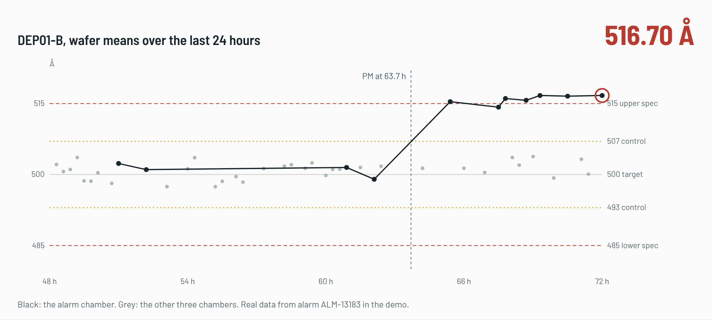
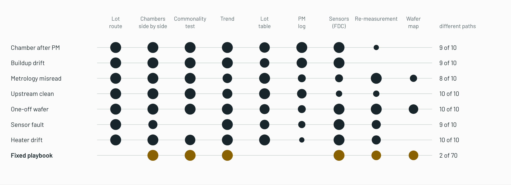

# FabTriage

**An agent that investigates semiconductor fab alarms and proposes what to do about them, with every claim checked against the evidence before an engineer signs off.**



- When a film-thickness alarm fires, the agent (Meta Muse Spark) pulls the lot route, compares chambers, runs a commonality test, re-measures when the answer depends on it, and files a disposition that cites each piece of evidence. A verifier sends back anything that cites a number not in the data or skips a playbook rule.
- On 70 held-out alarms it made the right call every time in three runs (95% interval 94.8 to 100), 21 points above a fixed playbook on the same alarms; after a chamber is held it brings it back to target with 0.23 off-target lots per recovery against 1.86 for the standard two-monitor-wafer rule.
- Pushed to a noise level where the evidence stops being readable, it fails safe (holds, not misses). All success criteria were written before the runs; one of the follow-up ideas did not work and the write-up says so.

**Live demo: https://yhwang55.github.io/fabtriage/** (a one-page overview with the results; the read-only console, built from saved runs, is at [/demo/](https://yhwang55.github.io/fabtriage/demo/))
Korean interface: https://yhwang55.github.io/fabtriage/demo/?lang=ko (agent output stays in its original English).

Built during the Meta Global AI Developer Hackathon (Oct 26 to Nov 4, 2026). Everything in this repository was written during the event.

## The problem

When a metrology or sensor alarm fires in a fab, an engineer has to work out why before the lot and the equipment can move again. Was it the deposition chamber, the measurement tool, the step before, a one-off wafer, or a broken sensor? The standard answer on the floor is to hold everything and look, which costs hours of lot delay and stops good chambers. A fixed rule-based playbook is faster but breaks on the cases that don't fit its thresholds.

FabTriage does the investigation the way an engineer would: it forms hypotheses, pulls the evidence that separates them, and files a disposition (root cause, actions, cited evidence) for sign-off.

## How it works

```
alarm ──> Muse Spark agent ──picks one tool per turn──> investigation tools (plain code)
                 ^                                           │ every result gets an evidence id
                 └────────────── result ─────────────────────┘
                 │
                 └──> submit_disposition ──> verification layer (plain code) ──> engineer sign-off
                                                  │ refused: problems go back to the agent
                                                  └ 3 refusals: goes to an engineer
```

- **Virtual fab** (`fabtriage/sim.py`): CLEAN (2 tools) → CVD DEP (4 chambers on 2 tools) → MET (2 tools). 72 hours of history, about half the lots sampled at 49 sites, FDC sensors on every run, chamber buildup drift, PM resets, run-to-run compensation.
- **Tools** (`fabtriage/tools.py`): alarm, lot history, lot table query, chamber box-plot summary, trends, commonality analysis (ANOVA per step), FDC summary, PM log, re-measurement (costs lot delay), and a wafer map segmented by **SAM 3.1**. All numbers are computed in code; the model decides what to look at.
- **Verification** (`fabtriage/verify.py`): runs inside `submit_disposition`, so the agent can't skip it. Every claim must cite an evidence id and every number in it must appear in that evidence. Playbook rules apply too, for example an out-of-spec lot can't be released without an in-spec re-measurement. It never sees the ground truth.
- **Models**: Muse Spark 1.3 (Meta Model API) runs the agent; SAM 3.1 reads wafer maps; Muse Spark Open on Baseten runs the same agent on open weights.



## Benchmark

7 scenario types × 6 seeds = 42 labeled cases. Seeds 1 to 4 are the dev set (28 cases); seeds 5 and 6 are held out (14 cases) and only run for the final comparison.

| Scenario | What happened | Correct response |
|---|---|---|
| pm_shift | chamber came back from PM running off-target | hold lot + chamber |
| buildup_drift | chamber overdue for PM, film drifting up, thick at the edge | hold lot + chamber |
| metrology_error | MET02 misreads | re-measure, release |
| upstream_clean | CLN02 problem shows up on every chamber | hold lot, escalate CLN02 |
| wafer_noise | one wafer out of control, chamber fine | release |
| sensor_fault | heater sensor reads high, film fine | flag sensor, release |
| heater_drift | heater really runs hot, film affected | hold lot + chamber |

About half the cases carry a confounder (a routine PM on the alarm chamber, the alarm wafer routed through the suspect tool, and so on). Each scenario is tied to public sources and practitioner input in [docs/SCENARIOS.md](docs/SCENARIOS.md).

Success criteria, fixed before building the agent:

- cause and decision accuracy on the held-out set above the fixed playbook
- zero missed real faults
- fewer needless holds than "always hold"
- 100% of accepted claims grounded in tool output (enforced by the verifier)
- cost: tool calls, re-measurements (lot delay), tokens

## Results

Every method runs on the same alarms, through the same tools and the same verifier. Decision accuracy means every required action was taken and no forbidden one (for example, releasing a lot from a faulty chamber).

**How the evaluation went.** The development set (28 cases) was used while building the agent. The first held-out set (seeds 5 and 6, 14 cases) was run once. We read its one failure, added one line of process knowledge to the agent, and checked that version on a second held-out set (seeds 7 and 8, 14 cases) that nobody had looked at. The agent runs three times on each held-out set to show run-to-run spread.

### Large held-out set (70 alarms, 50 recoveries)

The small sets above are too small to say much on their own, so the final check is a larger
held-out set nobody had looked at: 10 new seeds of every scenario. The analysis plan and six
pass/fail criteria were committed before the run ([docs/LARGE_EVAL.md](docs/LARGE_EVAL.md)).
Each case counts once; 95% intervals come from a bootstrap over cases, and comparisons are
paired on the same cases. All six criteria were met.

| Diagnosis, 70 alarms | Right decision | 95% interval | Missed real faults | Needless holds |
| --- | --- | --- | --- | --- |
| **Agent, Muse Spark 1.3 (3 runs)** | **100%** | 94.8 to 100 | **0** | **0** |
| Agent, Muse Spark Open on Baseten (1 run) | 94.3% | 88.6 to 98.6 | 1 | 0 |
| Agent without the verifier (1 run) | 100% | 94.8 to 100 | 0 | 0 |
| Same model, one shot, no tools (1 run) | 94.3% | 88.6 to 98.6 | 1 | 3 |
| Fixed playbook | 78.6% | 68.6 to 87.1 | 8 | 7 |
| Always hold | 42.9% | 31.4 to 54.3 | 0 | 40 |

The agent got all 70 alarms right in all three runs. Against the fixed playbook on the same
alarms it is 21.4 points better (95% interval 12.9 to 31.4); against the same model without
tools, 5.7 points (1.4 to 11.4). Without the verifier the decisions were just as good, but 19
of 70 dispositions did not cite the evidence the playbook requires (13 blamed the chamber
without a cited chamber comparison, 3 blamed the clean step without a commonality test, 3
called a wafer a one-off without the chamber's history). With the verifier on, those are sent
back until the evidence is there; none got through. The open-weights model's 4 misses were
all the same kind: it ran out of turns (20) without filing a disposition, and the console
sends those to an engineer unresolved; it never filed a wrong one. One of the four was a real
upstream fault, which is why it counts one missed fault.

| Recovery, 50 recoveries | Off-target lots per recovery | 95% interval | Out-of-spec lots | Monitor wafers |
| --- | --- | --- | --- | --- |
| **Agent, Muse Spark 1.3 (3 runs)** | **0.23** | 0.08 to 0.42 | **0** | 1.66 |
| Agent, Muse Spark Open on Baseten (1 run) | 0.20 | 0.04 to 0.40 | 0 | 2.6 |
| Two monitor wafers (guide rule) | 1.86 | 1.22 to 2.58 | 0 | 2.0 |
| Back to the baseline recipe | 2.56 | 1.78 to 3.40 | 16 | 0 |
| Keep the pre-PM recipe | 4.90 | 3.86 to 5.94 | 59 | 0 |

The agent has 1.63 fewer off-target lots per recovery than the best guide rule (95%
interval 0.99 to 2.33). Of its remaining off-target lots, 30 of 35 come from the metrology
offset case described below.

### Stress test: where it breaks

A perfect score on 70 alarms says little about margin, so the last test weakens the evidence
step by step (noisier film, fewer measured lots, faults that began more recently) and keeps
fault sizes the same. Plan written first: [docs/STRESS.md](docs/STRESS.md). The agent ran
three times per level; the other columns once.

| Level | Diagnosis: agent (3 runs) | Open model | No tools | Playbook | Recovery: agent (3 runs) | Open model | Two-monitor rule | Oracle |
| --- | --- | --- | --- | --- | --- | --- | --- | --- |
| 0 | 98.1% | 94.3% | 97.1% | 88.6% | 0.29 | 0.36 | 3.04 | 0.56 |
| 1 | 97.1% | 97.1% | 80.0% | 71.4% | 0.68 | 0.84 | 3.64 | 0.80 |
| 2 | 96.2% | 85.7% | 62.9% | 68.6% | 1.80 | 1.72 | 4.68 | 1.52 |
| 3 | 68.6% | 62.9% | 54.3% | 65.7% | 3.25 | 3.56 | 5.48 | 3.28 |

Diagnosis is right decisions (35 alarms per level); recovery is off-target lots per
recovery (25 per level). The agent holds up through level 2, ahead of the playbook by 9.5,
25.7 and 27.6 points (every paired interval above zero), while the playbook and the no-tools
model fall off. At level 3 its lead is gone (+2.9, interval spans zero) and the result is the
same in all three runs: 68.6%. It fails safe: 0, 0 and 1 missed faults at level 3 against the
playbook's 4, but 10 or 11 needless holds per run, mostly the same alarms each time. In
recovery it stays well below the guide rule and close to the oracle at every level with no
out-of-spec lots, but it did not run more monitor wafers as noise grew. A second version of
the prompt that asks for a second agreeing wafer was tested on fresh seeds
([docs/RECOVERY_V2.md](docs/RECOVERY_V2.md)): it spent the wafers and gained almost nothing
(2.52 against 2.64 lots per recovery at level 3, interval spans zero), because at high noise
the plain agent already sits on the oracle. What is left is the production controller, whose
weight the agent may set and almost never does. That is the next thing to work on.

**What a send-back does.** Engineers will reject some dispositions, so we took the 11 alarms
the agent got wrong at level 3 and investigated each again, once with a short engineer note
("not approved; check the film directly before holding equipment", never naming the answer)
and once with nothing. Without the note all 11 came back wrong again; with it, 3 were fixed,
both metrology misreads among them, at the cost of 0.6 more re-measurements per alarm. One
note pushed the agent toward releasing an out-of-spec lot and the verifier blocked it. A
send-back works when it names a check that settles the question; it cannot supply evidence
that is not there ([docs/FEEDBACK.md](docs/FEEDBACK.md)).

### Fresh held-out set, after the fix (14 cases)

| method | right decision | missed real faults | needless holds | tool calls | re-measures | lot delay (h) |
|---|---|---|---|---|---|---|
| **Agent, Muse Spark 1.3 (3 runs)** | **100% ± 0** | **0** | **0** | 10.3 | 0.79 | 1.18 |
| Agent, Muse Spark Open on Baseten | 100% | 0 | 0 | 14.1 | 1.07 | 1.61 |
| Agent without the verifier | 100% | 0 | 0 | 9.8 | 0.57 | 0.86 |
| Same model, one shot, no tools | 93% | 0 | 1 | 10 (fixed) | 0 | 0 |
| Fixed playbook | 71% | 3 | 1 | 7.4 | 0.71 | 1.07 |
| Always hold | 43% | 0 | 8 | 4.0 | 0 | 0 |

### First held-out set, before the fix (14 cases)

| method | right decision | missed real faults | needless holds | tool calls | re-measures |
|---|---|---|---|---|---|
| **Agent, Muse Spark 1.3 (3 runs)** | **97.6% ± 4.1** | **0** | 0.3 | 9.7 | 0.64 |
| Agent, Muse Spark Open on Baseten | 93% | 0 | 1 | 14.6 | 1.21 |
| Agent without the verifier | 100% | 0 | 0 | 9.8 | 0.71 |
| Same model, one shot, no tools | 71% | 0 | 4 | 10 (fixed) | 0 |
| Fixed playbook | 86% | 2 | 0 | 7.4 | 0.71 |
| Always hold | 43% | 0 | 8 | 4.0 | 0 |

Development set (28 cases): agent 100%, fixed playbook 86% (2 missed faults), always hold 43%.

### The one failure, and the fix

`sensor_fault-6` failed in one of three runs (and in the Muse Spark Open run). The heater sensor read 13 °C high but the film was fine. The agent re-measured the alarm lot, found it about 6 Å *thinner* than the chamber's usual level (still inside control limits), and read that as proof of a real heater change. A hotter heater deposits faster, so a real change would have made the film thicker. We added one line of process knowledge to the agent's instructions: deposition rate rises with temperature, so film that stays in control or moves the other way points to the sensor ([source](docs/SCENARIOS.md#heater-drift)). On the fresh held-out set the sensor and heater cases were right in all six runs.

### What the comparisons show

- **Investigating beats answering.** The same model given a fixed evidence pack and one shot at the answer was right 71% and 93% of the time on the two held-out sets, and broke a playbook rule in 4 of those 28 cases (on the development set, it released out-of-spec lots without a confirming re-measurement five times). The agent asks for a re-measurement when the answer depends on it.
- **The verifier keeps evidence complete; it did not change accuracy here.** Without it the agent made the same decisions, but 1 of 14 and 4 of 14 dispositions would have reached the engineer missing evidence the playbook requires (for example, holding a chamber without citing a comparison to the other chambers). Muse Spark never cited a number that was not in its tool output.
- **Open weights work too, with a gap.** Muse Spark Open on Baseten matched the accuracy on the fresh 14-case set; on the 70-alarm set it was 94.3% against 100%, and under stress it fell further behind at the two hardest levels. It uses more tool calls, re-measurements and monitor wafers. Its recoveries are as good.
- **The cost.** The agent does slightly more re-measuring than the playbook on the fresh set (1.18 vs 1.07 lot-hours per alarm) in exchange for zero missed faults instead of three.

### Per 100 alarms (fresh held-out set, illustrative)

| method | engineer hours | needless holds | missed faults | lots at risk |
|---|---|---|---|---|
| Always hold (manual investigation) | 250 | 57 | 0 | 0 |
| Fixed playbook | 17 | 7 | 21 | 43 |
| **Agent** | **17** | **0** | **0** | **0** |

Assumptions, from `python -m fabtriage impact`: a manual investigation of a held alarm takes 2.5 engineer hours (a practicing fab data scientist told us false-alarm holds usually clear in 2 to 3 hours); reviewing a cited disposition takes about 10 minutes; a missed chamber fault runs about two more lots before the next sampled wafer catches it. These are estimates, not fab measurements.

### Limits

- The fab is simulated and small: one deposition step, four chambers, seven fault types. Real fabs have more tools, more steps and faults no list anticipates.
- The two small held-out sets have 14 cases each; the large set (70 alarms, 50 recoveries) is what the intervals above rest on. A 100% result on 70 cases still only bounds the error rate below about 5%.
- The scenarios follow public sources and practitioner input ([docs/SCENARIOS.md](docs/SCENARIOS.md)), but the simulator is not calibrated to production data.

## Recovery after PM

Diagnosis ends with "hold the chamber". The second job starts there: bring the held chamber
back to the 500 Å target and release it. The idea comes from Prof. Jang (장재연, The Catholic
University of Korea): run-to-run models need many runs and lose their footing after PM, so
engineers re-center the recipe with guide rules and experience. Can the agent do that part?

The agent reads the PM record, the chamber's history from earlier PMs and the latest
metrology matching check, runs up to four monitor wafers (0.5 h of chamber time each), gets
a recipe from a rate estimate, and releases the chamber with cited evidence. The same kind of
verifier checks every release: numbers must come from evidence, a chamber that was opened
needs at least one monitor wafer, and one recipe change is capped at 8%. Then 40 production
lots run under an EWMA controller and are scored on the true film.

Five hidden scenarios: the clean reset the rate, seasoning was skipped (first wafers come out
thin), a new part drifts fast, a metrology tool reads high, and nothing changed. Compared
against keeping the old recipe, going back to the baseline recipe, and a two-monitor-wafer
rule. Success criteria were written before any agent run: [docs/RECOVERY.md](docs/RECOVERY.md).

Results on a fresh held-out set (10 recoveries, agent run 3 times, after one fix described
below):

| Method | Off-target lots | Out-of-spec lots | Monitor wafers per recovery |
| --- | --- | --- | --- |
| Agent (Muse Spark 1.3) | 2 ± 0 | 0 | 1.67 |
| Two monitor wafers (guide rule) | 21 | 0 | 2 |
| Back to the baseline recipe | 26 | 3 | 0 |
| Keep the pre-PM recipe | 39 | 6 | 0 |

All five pre-registered criteria were met on both held-out sets. On the first one, one run in
30 went badly: the agent copied a thickness slope of -0.82 Å per lot into a field that expects
thinning as a positive number, and 24 lots went off target. The verifier now refuses a
negative drift with a message saying which sign to use, and the fixed version was checked on
the fresh set above. The 2 remaining lots come from a metrology tool that reads high: the agent
measures its monitor wafers on the good tool, but production feedback still mixes in the
biased one. Full account: [docs/RECOVERY.md](docs/RECOVERY.md).

**Is the answer planted?** The scenarios leave clues in the PM record and the chamber's
earlier PMs, so we hid them and ran again (criteria written first). With earlier PMs hidden,
PM details hidden, or both, the agent had 9, 5 and 9 off-target lots, still under the rule's
21, with no out-of-spec lots and more monitor wafers (2.1 to 2.5). It found skipped
seasoning from the monitor wafers alone; it lost lots only on the new-part drift, which no
monitor wafer can show in advance. The open model (Muse Spark Open on Baseten) had 2
off-target lots with 2.5 monitor wafers per recovery.

**From diagnosis to recovery.** For the four development alarms where a chamber came back from
PM running thick, the console links the diagnosis to a recovery of the same chamber and PM.
The agent brought all four back with no off-target lots, using 1 or 2 monitor wafers.

**Cost.** A diagnosis uses about 50 to 58 thousand tokens and a recovery about 35 thousand
(Muse Spark 1.3, measured over the benchmark runs). At $1.25 per million input tokens and
$4.25 per million output tokens, that is under $0.25 per alarm and under $0.15 per recovery
even if every token were billed at the output price; most tokens are input, so the real figure
is closer to $0.07 and $0.05. Wall time over the benchmark runs: a diagnosis takes about 22
seconds (median; the open model on Baseten about 27) and a recovery about 31 seconds, with a
long tail when the API rate-limits and the client retries.

```bash
python -m fabtriage recover --method monitor_rule --split holdout
python -m fabtriage recover --method agent --split holdout --repeats 3
python -m fabtriage recover-report --split holdout
python -m fabtriage recover --method agent --split holdout2 --hide history pm_detail   # clue-removal check
```

## Run it

See it without an API key:

```bash
pip install -r requirements.txt
python -m fabtriage demo      # opens the read-only demo in your browser
```

Everything else:

```bash
python3 -m venv .venv && source .venv/bin/activate
pip install -r requirements.txt
cp .env.example .env          # add MODEL_API_KEY (and BASETEN_API_KEY for batch runs)
python -m pytest -q           # no API calls

python -m fabtriage cases --split dev
python -m fabtriage eval --method playbook --split dev
python -m fabtriage run  --case pm_shift-1 --method agent              # one case, Muse Spark
python -m fabtriage eval --method agent --split dev --limit 3          # a few cases first
python -m fabtriage eval --method agent --split dev --backend baseten  # Muse Spark Open
python -m fabtriage compare --split dev
```

Each run writes `runs/<method>/<case>/run.json` with the full trace, refusals, costs and the score.

## Demo site

`python -m fabtriage export --out docs/demo` writes the console as a static, read-only site from the saved runs; GitHub Pages serves it from `docs/`. It has the alarm queue, every investigation with a step-by-step replay, the side-by-side comparison and the benchmark. Live investigations and sign-off need an API key, so they run in the local version:

```bash
cp .env.example .env    # add your MODEL_API_KEY
python -m fabtriage serve
```


The front page (`docs/index.html`) is generated from the same saved results: `python scripts/build_landing.py`, after `export`.
## Console

```bash
python -m fabtriage serve     # http://127.0.0.1:8770
```

The first screen is the alarm queue: what needs an engineer, then proposed holds, then proposed releases. Open an alarm to see the verdict card (decision, cause, the evidence behind it, sign-off) and, below it, the investigation step by step: each tool call with its evidence id, the agent's reasoning, verifier refusals, the final disposition with every claim linked back to its evidence, the chamber's SPC chart and the SAM-segmented wafer maps. An engineer approves the disposition, or rejects it with a note and the agent investigates again with that note. The Benchmark tab compares the agent with the baselines.

## Scope note

This is a simplified, simulated fab. Process numbers are illustrative, not from any real fab. The scenarios follow failure modes that practicing fab data scientists described, but the simulator is not calibrated to production data.
